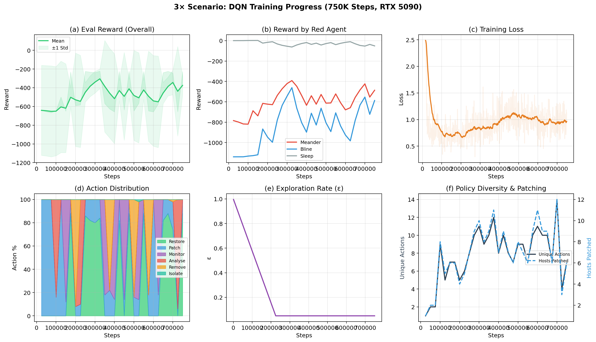
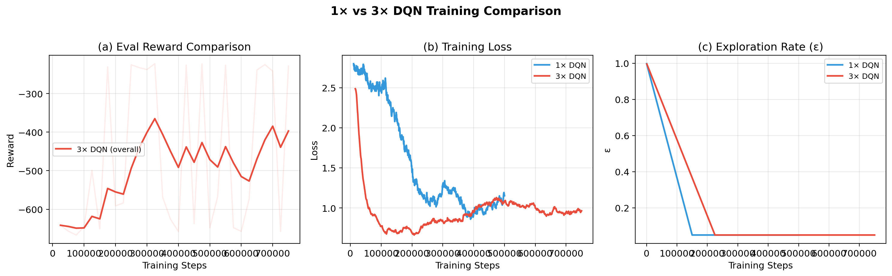
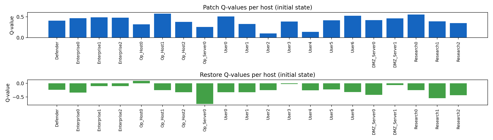

# RL_CYB — Reinforcement Learning for CybORG (CAGE Challenge)

A compact project README describing the repository structure, versioned scenarios, and the 3× scalability results (charts + tables). The repository contains training/evaluation code, STIX/ATT&CK exports, trained models and LaTeX paper artifacts.

---

## Quick links

- Paper (LaTeX): `Cyb_org_simulation-integration.tex`
- Paper (PDF): `CYBORG-Simulation-RL.pdf` (not rebuilt here)
- Training scripts: `train_dqn_3x.py`, `train_ppo_cyborg.py`
- Evaluation: `eval_dqn_3x.py`, `eval_shaped_vs_random*.py`
- STIX / Navigator exports: `stix_export/` (JSON, CSV, heatmap)
- Models & logs: `ppo_out/dqn_3x_v1.zip`, `ppo_out/*` logs

---

## Project architecture (high level) 🔧

- `train_*.py` — training entry points (DQN / PPO / LSTM-PPO)
- `eval_*.py` — evaluation scripts and policy analyses
- `export_stix.py` — export simulation episodes to STIX 2.1 + ATT&CK Navigator layers
- `stix_export/` — generated Navigator JSONs, `q_metadata.json`, CSVs and heatmaps
- `ppo_out/` — saved policies & TensorBoard logs
- `CybORG/` / `cage-challenge-1/` — environment code (CybORG integration)
- `Cyb_org_simulation-integration.tex` — manuscript; appendix now contains policy evidence tables
- images / figures — training and analysis PNGs referenced by the paper

---

## Versions & scenarios 📦

- 1× (baseline Scenario 1b)
  - Hosts: 13, Subnets: 3
  - Action types: Monitor, Analyse, Remove, Restore
  - Training scripts: baseline `train_*.py`

- 3× (extended / scaled experiment)
  - Hosts: 20, Subnets: 5, Action types: 6 (adds `Isolate`, `Patch`)
  - Action space: `6 × 20 = 120` discrete actions
  - Observation dim ≈ 121; 3 Red agent profiles (B_line, Meander, Sleep)
  - Trained model: `ppo_out/dqn_3x_v1.zip`

---

## 3× scalability — summary (charts & tables) 📊

### Scaling comparison

| Dimension | 1× baseline | 3× extended |
|---|---:|---:|
| Hosts | 13 | **20** |
| Subnets | 3 | **5** |
| Action types | 4 | **6** |
| Action space | 52 | **120** |
| Observation dim | 52 | **121** |
| Red agents | 1 (B_line) | **3 (B_line, Meander, Sleep)** |
| Training steps | 500,000 | **750,000** |
| GPU / throughput | — | NVIDIA RTX 5090 (~308 FPS) |

### Performance: DQN (3×) vs random baseline

| Red profile | DQN (mean ± sd) | Random baseline | Improvement |
|---|---:|---:|---:|
| Meander (adaptive) | -308.5 ± 41.2 | -415.2 ± 236.5 | +106.7 |
| B_line (targeted APT) | -279.8 ± 3.1 | -784.5 ± 348.9 | +504.8 |
| Sleep (no-op) | -87.5 ± 0.0 | -13.2 ± 4.4 | -74.3 |
| Active-adversary mean | -294.2 | -599.9 | +305.7 |
| **Overall** | **-225.3** | **-404.3** | **+179.0** |

Mean ± std over 30 episodes per cell (seeds 0–2 × 10 episodes × 100 steps; DQN deterministic). Logs: `eval_logs_a1/table3_3x/`. These replace the earlier 3-episode random baselines.

> Interpretation: the 3× policy runs a fixed `Patch` → `Restore Op_Server0` loop under every profile. It cuts active-adversary penalty by 51.0% vs. random (narrower vs. Meander than vs. B_line) but is 6.6× worse than random with no adversary. Rewards include the wrapper's Isolate/Patch shaping terms (Isolate −0.5 first / −0.1 repeat; Patch +0.5 first; +0.2 per action on an isolated host).

### Key hyperparameters (3× DQN)

| Parameter | Value |
|---|---:|
| Learning rate | 1e-4 |
| Batch size | 128 |
| Discount (γ) | 0.99 |
| Network | [512, 256, 128] |
| Replay buffer | 200,000 |
| ε (exploration) | 1.0 → 0.05 (linear, first 30%) |
| Target update | 2,000 steps |
| Training steps | 750,000 |

### Policy evidence — selected per-host Q / counts (excerpt)

| Host | patch_Q | restore_Q | patch_# (B_line) | restore_# (B_line) |
|---|---:|---:|---:|---:|
| `Op_Host1` | 0.575 | -0.250 | 20 | 0 |
| `Op_Server0` | 0.256 | -0.752 | 0 | **900** |
| `Enterprise0` | 0.466 | -0.337 | 20 | 0 |
| `DMZ_Server0` | 0.420 | -0.423 | 20 | 0 |
| `Research0` | 0.554 | -0.250 | 20 | 0 |

(full CSVs: `stix_export/policy_host_q_summary.csv` and `stix_export/policy_technique_summary.csv`)

### Charts (open these images in repo)

- Training curves (3×): `training_3x_curves.png`

  

- 1× vs 3× comparison: `training_1x_vs_3x.png`

  

- Q heatmap (Patch / Restore per-host): `stix_export/q_values_patch_restore.png`

  

---

## Where to find artifacts

- Navigator layers & CSVs: `stix_export/`
- Model checkpoints & logs: `ppo_out/`
- Scripts to regenerate figures: `generate_q_heatmaps.py`, `export_policy_tables.py`, `generate_training_plots_for_paper.py`

---

## How to reproduce (high level)

1. Train DQN (3×): `python train_dqn_3x.py`
2. Evaluate: `python eval_dqn_3x.py`
3. Export STIX / Navigator layers: `python export_stix.py`
4. Regenerate CSV/figures: `python export_policy_tables.py` / `python generate_q_heatmaps.py`

(Compilation of the LaTeX paper is not performed automatically in this README.)

---

## Notes & next steps ✨

- The STIX exports now include per-technique metadata linking ATT&CK techniques to the learned policy (preferred Q action, empirical top action, evidence links). See `stix_export/` for layer JSONs and `q_metadata.json` for per-action evidence.
- Optional: add a GitHub Action to build the PDF automatically on push (I can add that if you want).

---

Maintainer: Vasanth Iyer — see `Cyb_org_simulation-integration.tex` for paper details.
